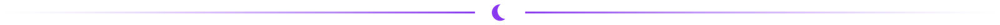
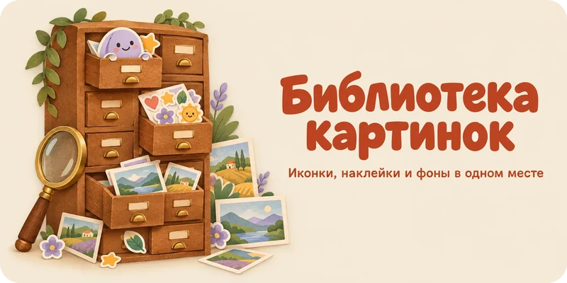
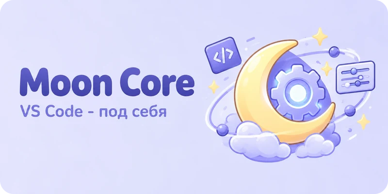
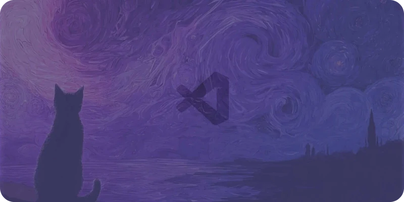
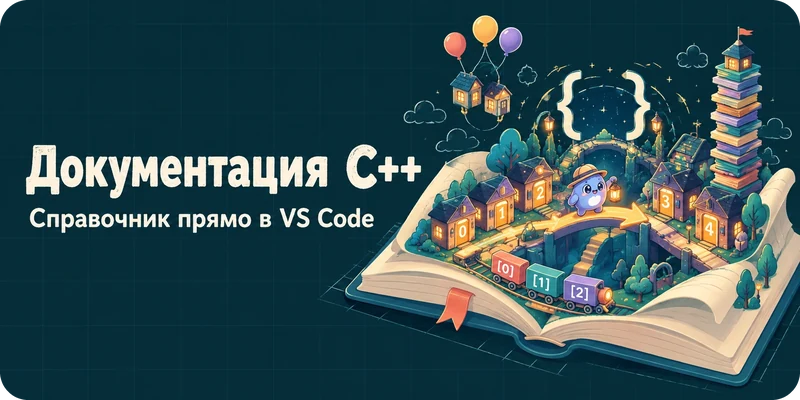
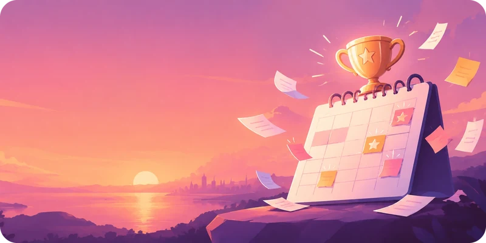

<picture>
  <source media="(prefers-color-scheme: dark)" srcset="assets/banner-dark.webp">
  
</picture>

<picture>
  <source media="(prefers-color-scheme: dark)" srcset="assets/divider-dark.webp">
  
</picture>

## Главные проекты

<table>
<tr>
<td width="33%" valign="top">
 
<b><a href="https://github.com/moonlivedt-oss/photosMOONprojects">Библиотека картинок</a></b>&nbsp; 
своя библиотека иконок, наклеек и фонов: нарезка сгенерированных листов, поиск по смыслу, ИИ-помощники через MCP, ассеты Unreal Engine с 3D-просмотром
</td>
<td width="33%" valign="top">
 
<b><a href="https://github.com/moonlivedt-oss/moon-core">Moon Core</a></b>&nbsp; 
конструктор интерфейса VS Code: кликни по элементу - убери, увеличь, перекрась; профили вида, живые сниппеты, пипетка
</td>
<td width="33%" valign="top">
 
<b><a href="https://github.com/moonlivedt-oss/custom_VScode">MoonLight custom-bg</a></b> 
живой фон и панель оформления VS Code: картинки по зонам, наборы с палитрой, генеративные фоны, слайдшоу
</td>
</tr>
<tr>
<td width="33%" valign="top">
 
<b><a href="https://github.com/moonlivedt-oss/cpp-panel-Moon">Документация C++</a></b> 
справочник проекта в VS Code: плавающее окно-читалка и боковая панель, поиск, прогресс изучения
</td>
<td width="33%" valign="top">
 
<b><a href="https://github.com/moonlivedt-oss/VSCLwMoon">VS Code Launcher</a></b> 
запускает VS Code только с нужными стеками расширений - тяжёлые языковые серверы не грузятся
</td>
<td width="33%" valign="top">
 
<b><a href="https://github.com/moonlivedt-oss/NetworkDoctor">Сетевой доктор</a></b> 
чинит интернет в Windows, когда после VPN-туннелей и прокси связь «слетает»: диагностика, починка, мониторинг
</td>
</tr>
<tr>
<td width="33%" valign="top">
 
<b><a href="https://github.com/moonlivedt-oss/AutoTranslatorMoon">AutoTranslator</a></b>&nbsp; 
плавающий переводчик поверх окон: OCR экрана, живой перевод новелл и игр, мост для Ren'Py, офлайн-режим
</td>
<td width="33%" valign="top">
 
<b><a href="https://github.com/moonlivedt-oss/ContestReminderMoon">ContestReminder</a></b>&nbsp; 
трей-напоминалка о конкурсах: ловит пост из буфера или с экрана, сама находит дедлайн и напоминает
</td>
<td width="33%" valign="top">
 
<b><a href="https://github.com/moonlivedt-oss/PlagWebMoon">One Page Site Builder</a></b> 
расширение VS Code: одностраничный сайт за пару минут без кода - мастер, 25 типов секций, живой предпросмотр
</td>
</tr>
</table>

<b>Библиотека картинок в работе</b> (анимация, 1 МБ)

 

## Конкурсы, игры и сайты

Соревнования по данным, конкурсные кейсы, сайты и первая игра на Godot.

<b>Показать 6 проектов</b>

 

| Проект | Что это |
|---|---|
|  **[ECUP26: матчинг товаров](https://github.com/moonlivedt-oss/OzonAi2026_Moon)** | cross-encoder решает, дубликаты ли две карточки товара маркетплейса (соревнование ODS) |
|  **[Drivee AI: NL→SQL](https://github.com/moonlivedt-oss/SuperDrivee-IA-sql)** | вопрос на русском -> SQL -> результат: RAG, guardrails и объяснения (кейс «Моя профессия - ИТ») |
|  **[Drivee: такси с устойчивым GPS](https://github.com/moonlivedt-oss/Moon-sBadTaxi)** | прототип такси на 2GIS MapGL: машина на карте едет без «прыжков» по зданиям |
|  **[PROFразвитие](https://github.com/moonlivedt-oss/ProfRazvitieMoon)** | интерактивная платформа о профессиях для подростков и родителей |
|  **[Book Club «Страница»](https://github.com/moonlivedt-oss/BookClubMoon)** | лендинг книжного клуба: каталог, профили читателей, встроенный ридер (Vue 3, PHP, Three.js) |
|  **[МИРО](https://github.com/moonlivedt-oss/MIRO_beta)** | психологический хоррор от первого лица на Godot 4 - первый проект на движке |

<picture>
  <source media="(prefers-color-scheme: dark)" srcset="assets/divider-dark.webp">
  
</picture>

 
Нашли баг или есть идея - пишите в Issues нужного проекта.

